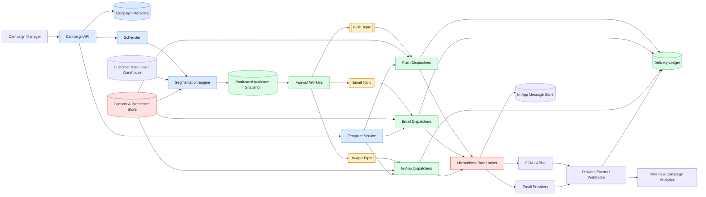
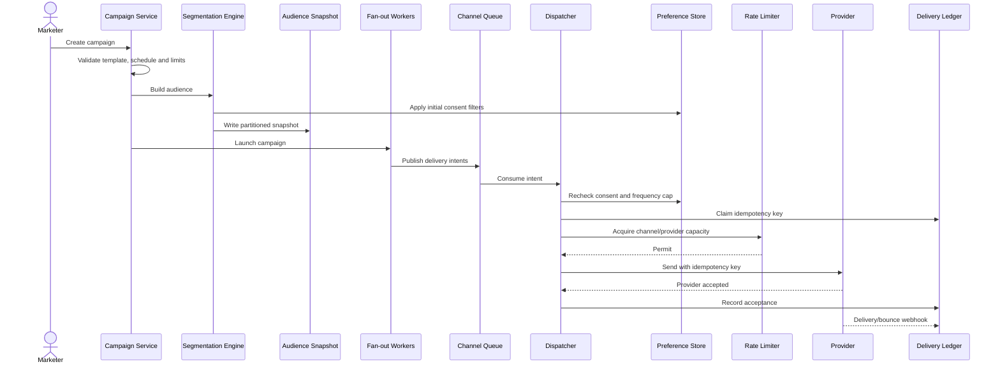
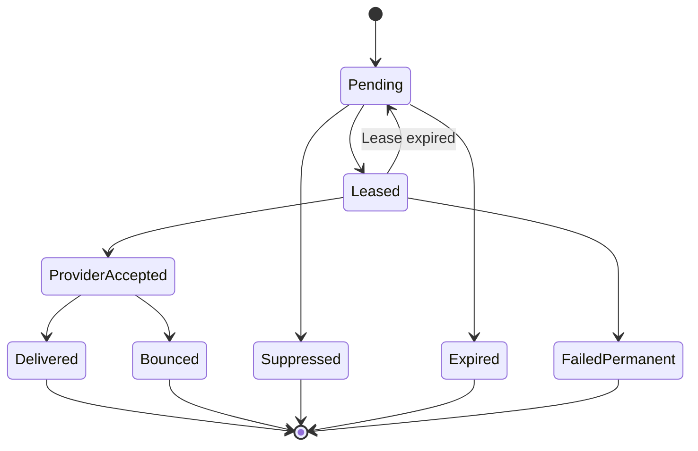

# Large-Scale Marketing Notification System

> [!IMPORTANT]
> **Core idea:** Snapshot the audience, create durable delivery intents, recheck consent at dispatch, and send through independently scalable channel workers with idempotency and provider-aware rate limiting.

## 🟦 Requirements

### Functional

- Send marketing notifications to **50 million customers**.
- Channels: push, email, and in-app.
- Segment users by geography, behavior, subscription tier, and other attributes.
- Support scheduling, local time zones, quiet hours, personalization, and A/B variants.
- Respect channel preferences, opt-outs, suppression lists, and frequency caps.
- Track campaign progress, provider acceptance, delivery, bounce, failure, and expiry.
- Allow campaigns to be paused, resumed, or cancelled.

### Non-functional

- High throughput during major launches.
- Reliable and timely delivery.
- Effective duplicate prevention.
- Independent channel scaling and failure isolation.
- Privacy, auditability, and data residency.
- Cost-efficient storage and compute.

## 🟨 Scale Estimation

| Item | Estimate |
|---|---:|
| Customers | 50 million |
| Maximum channels per customer | 3 |
| Maximum delivery intents | 150 million |
| Target launch duration | 30 minutes |
| Required average throughput | `150M / 1,800 ≈ 83K/sec` |
| Provisioned peak throughput | **150K deliveries/sec** |
| Audience snapshot size | Approximately 5-15 GB |
| Queue/event volume at 1 KB each | Up to approximately 150 GB |

> [!NOTE]
> Marketing delivery tolerates seconds or minutes of latency. The design should optimize for throughput, reliability, consent safety, and predictable campaign completion—not millisecond latency.

## 🟩 High-Level Architecture



### Control plane

- Campaign creation and approval.
- Segment definition and audience estimation.
- Template and localization management.
- Scheduling, pause, resume, and cancellation.
- Reporting and audit history.

### Delivery data plane

- Audience partition processing.
- Delivery-intent creation.
- Preference and frequency-cap enforcement.
- Personalization.
- Provider rate limiting.
- Sending, retries, and delivery-state tracking.

## 🟦 End-to-End Flow



### Flow details

1. Marketer defines the audience, channels, template, schedule, frequency cap, and expiry.
2. Campaign service validates variables, links, legal footer, estimated audience, and provider limits.
3. Segmentation engine evaluates the audience using the analytics warehouse.
4. Eligible users are stored in an immutable, partitioned audience snapshot.
5. Scheduler gradually releases snapshot partitions at launch time.
6. Fan-out workers create channel-specific delivery intents.
7. Channel worker rechecks current preferences and campaign status.
8. Worker claims the delivery idempotency key.
9. Personalization is rendered from a versioned template.
10. Hierarchical rate limiter grants provider capacity.
11. Provider acknowledgement and later webhook events update delivery status.

## 🟪 Audience Segmentation

### Accepted: precomputed audience snapshot

```text
Segment definition
    ↓
Warehouse query
    ↓
Consent and suppression filtering
    ↓
Deterministic partitioning
    ↓
Immutable audience snapshot
```

Snapshot fields should be minimal:

```text
user_id
region
timezone
preferred_language
subscription_tier
eligible_channels
template_variables
experiment_variant
```

### Why not query production databases during delivery?

- A 50-million-user scan would overload transactional databases.
- The audience could change while the campaign is running.
- Campaign counts would not be reproducible.
- Personalization lookups would become the main throughput bottleneck.

> [!WARNING]
> Consent must be checked twice: once while creating the snapshot and again immediately before dispatch. A customer may opt out after segmentation.

## 🟧 Scheduling and Launch Control

- Store scheduled campaigns in minute-level time buckets.
- Partition the audience before the scheduled time.
- Gradually release partitions to avoid a thundering herd.
- Apply random jitter where exact simultaneous delivery is unnecessary.
- Respect recipient time zones and quiet hours.
- Define a campaign expiry time.
- Check campaign status before every external send.

```text
SCHEDULED → PREPARING → READY → RUNNING
                         ↓         ↓
                       PAUSED   COMPLETED
                         ↓
                      CANCELLED
```

Workers must stop dispatching when a campaign is paused or cancelled, even if messages remain in channel queues.

## 🟥 Delivery Guarantees and Deduplication

### Delivery model

Use **at-least-once processing with idempotency**.

Strict exactly-once delivery cannot be guaranteed across external providers:

```text
Provider accepts message
        ↓
Worker crashes before recording acceptance
        ↓
Retry may send a duplicate
```

Pass the same idempotency key to providers that support idempotent requests:

```text
delivery_id =
hash(campaign_id, occurrence_id, user_id, channel, variant)
```

### Delivery state machine



### Duplicate protection

1. **Fan-out deduplication:** conditionally insert the delivery record by `delivery_id`.
2. **Dispatcher deduplication:** check delivery state before sending.
3. **Provider idempotency:** reuse `delivery_id` for every retry.
4. **In-app uniqueness:** unique constraint on campaign occurrence and user.

Workers claim deliveries with expiring leases. If a worker crashes, another worker can safely continue after lease expiration.

## 🟨 Personalization

Templates are immutable and versioned after launch.

```text
Template
├── Subject/title
├── Body
├── Channel layout
├── Required variables
├── Locale variants
└── Safe fallback values
```

Avoid synchronous profile-service calls for every delivery.

- Materialize common variables into the audience snapshot.
- Batch-fetch uncommon attributes.
- Cache reusable data.
- Reject campaign launch if required fields are missing.
- Never allow retries to switch template or experiment variant.

### Deterministic A/B assignment

```text
variant = hash(campaign_id, user_id) % variant_count
```

## 🟥 Preferences, Suppression and Frequency Caps

Preference store contains:

```text
user_id
email_allowed
push_allowed
in_app_allowed
topic_preferences
quiet_hours
timezone
global_opt_out
updated_at
```

Additional suppression sources:

- Email bounces and complaints.
- Invalid push tokens.
- Legal or regional restrictions.
- Campaign-specific exclusions.
- Per-user daily and weekly frequency limits.

> [!CAUTION]
> If the preference service is unavailable, marketing delivery must **fail closed**. Do not send.

## 🟧 Hierarchical Rate Limiting

```text
Global channel limit
  └── Provider account limit
       └── Region/domain limit
            └── Campaign limit
                 └── Per-user frequency cap
```

Use distributed token buckets, with fast local buckets for worker-level smoothing and Redis or another shared store for global coordination.

Provider `429` responses should:

1. Reduce the corresponding provider bucket.
2. Retry with exponential backoff and jitter.
3. Increase throughput gradually after recovery.

Separate channel topics allow email, push, and in-app traffic to scale and fail independently.

## 🟦 Channel-Specific Design

| Channel | Important handling |
|---|---|
| Push | FCM/APNs token registry, multiple devices, payload limits, invalid-token cleanup |
| Email | Bounce and complaint processing, unsubscribe headers, domain throttling, suppression lists |
| In-app | Persistent inbox, visibility windows, read/dismiss state, unique insertion |

For email, support multiple providers behind a common adapter. Failover must reuse the same delivery idempotency key.

## 🟪 Core Data Model

### Campaign

```text
campaign_id
name
status
segment_definition
channels
template_versions
scheduled_at
expires_at
frequency_cap
created_by
approved_by
created_at
```

### Audience snapshot record

```text
campaign_id
snapshot_version
partition_id
user_id
eligible_channels
timezone
locale
template_variables
variant
```

### Delivery ledger

```text
delivery_id
campaign_id
occurrence_id
user_id
channel
status
attempt_count
lease_owner
lease_expires_at
provider_message_id
last_error
created_at
updated_at
```

Do not partition the ledger only by `campaign_id`; a major launch would create a hot partition. Partition by a hash of `delivery_id` or `user_id`.

## 🟧 Storage Choices

| Data | Storage |
|---|---|
| Campaigns, schedules and templates | Relational database |
| Audience snapshots | Object storage |
| Delivery ledger | DynamoDB, Cassandra, Bigtable, or similar NoSQL store |
| Consent and preferences | Strongly consistent key-value or relational store |
| In-app inbox | NoSQL store partitioned by user |
| Queues | Kafka, Pulsar, or managed cloud streaming |
| Rate-limit counters | Redis plus local token buckets |
| Analytics | Event stream and data warehouse |

## 🟥 Failure Handling

| Failure | Handling |
|---|---|
| Dispatcher crash | Lease expires; another worker resumes |
| Provider timeout or `5xx` | Exponential backoff with jitter |
| Provider `429` | Reduce rate and retry later |
| Invalid token/address | Permanent failure; update token or suppression store |
| Preference service unavailable | Fail closed |
| Queue backlog | Autoscale workers and slow campaign admission |
| Bad template | Canary send, validation, emergency cancellation |
| Provider outage | Pause channel or fail over to another provider |
| Repeated failure | Dead-letter queue with controlled redrive |
| Missing webhook | Periodic provider-status reconciliation |

Retries must stop after the campaign expiry time.

## 🟩 Monitoring

### Campaign dashboard

```text
Targeted
Suppressed
Queued
Provider accepted
Delivered
Failed permanently
Expired
```

### Important metrics

- Queue depth and oldest-message age.
- Campaign completion percentage.
- Scheduled-to-provider-accepted latency.
- Delivery, bounce, complaint, and invalid-token rates.
- Retry and dead-letter rates.
- Provider latency and throttling.
- Duplicate rate.
- Suppression and opt-out counts.
- Frequency-cap violations.
- Cost per accepted and delivered notification.
- Opt-out delivery violations: **target zero**.

Every delivery should be traceable using:

```text
campaign_id
user_id
delivery_id
channel
template_version
provider_request_id
```

## 🟫 Privacy and Compliance

- Store the legal basis and source of consent.
- Process unsubscribe requests immediately.
- Maintain durable suppression lists.
- Recheck consent immediately before dispatch.
- Minimize personal data in queues and snapshots.
- Encrypt data in transit and at rest.
- Apply regional processing and data-residency rules.
- Protect campaign and audience access with RBAC.
- Audit creation, approval, launch, cancellation, and data access.
- Support deletion and retention requirements.
- Avoid sensitive data in notification events.

Applicable regulations may include GDPR, CCPA, CAN-SPAM, and regional communication rules.

## 🟩 Cost Efficiency

- Keep large audience snapshots in inexpensive object storage.
- Send compact identifiers and required variables through queues.
- Batch provider requests where supported.
- Autoscale workers using queue lag.
- Keep only a small baseline worker fleet outside major launches.
- Apply TTLs to detailed delivery records.
- Use external email and push providers instead of operating SMTP or push infrastructure.
- Keep analytics processing outside the critical delivery path.
- Avoid synchronous per-user profile database calls.

## 🟪 Key Decisions

| Approach | Verdict | Why |
|---|---|---|
| Query production DB during launch | ❌ Reject | A 50M-user scan overloads transactional systems and creates unpredictable delivery |
| Immutable audience snapshot | ✅ Accept | Gives stable counts, auditability, reproducibility, and parallel processing |
| Strict exactly-once delivery | ❌ Reject | Provider acknowledgement creates an unavoidable failure window |
| At-least-once plus idempotency | ✅ Accept | Reliable delivery with practical duplicate protection |
| One queue for all channels | ❌ Reject | Provider limits and failure behavior differ by channel |
| Separate channel topics | ✅ Accept | Independent scaling, retries, backpressure, and failure isolation |
| Per-message profile lookup | ❌ Reject | Creates a high-throughput dependency and likely bottleneck |
| Materialized personalization fields | ✅ Accept | Isolates delivery from profile-service failures |
| Build email and push infrastructure | ❌ Reject | Reputation, deliverability, and platform protocols are operationally expensive |
| Provider abstraction layer | ✅ Accept | Reduces operational cost and permits provider failover |

## 🟦 Interview Summary

```text
1. Build an immutable audience snapshot from the analytics warehouse.
2. Partition it and gradually fan out channel-specific delivery intents.
3. Use durable per-channel queues.
4. Recheck preferences and frequency caps immediately before dispatch.
5. Personalize through versioned templates and pre-materialized variables.
6. Use at-least-once processing with delivery idempotency keys.
7. Apply hierarchical provider-aware rate limiting and backpressure.
8. Track every delivery in a scalable ledger.
9. Retry transient failures, suppress permanent failures, and expire late work.
10. Monitor delivery, duplicates, consent violations, provider health, and cost.
```
